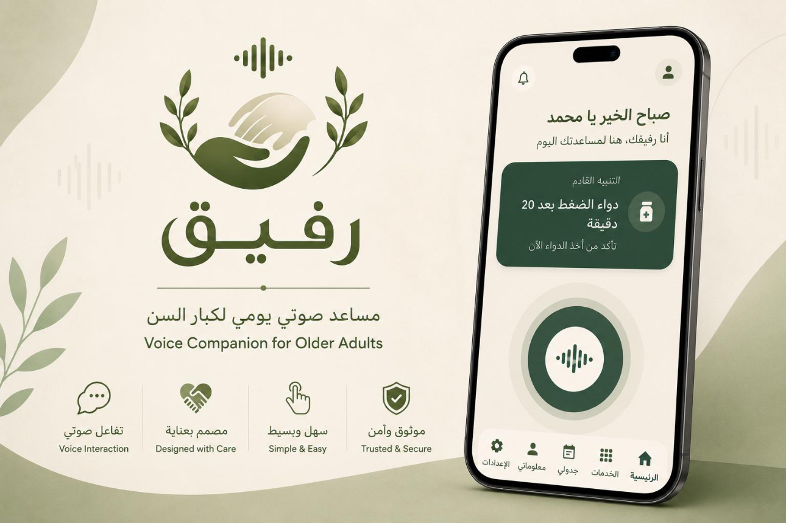

# Rafeeq | رفيق

  

  <strong>An accessible Arabic voice companion that helps older adults manage everyday tasks.</strong>

Rafeeq (رفيق) is a team-built MVP for older adults in Saudi Arabia. It brings reminders, prayer times, Quran audio, family communication, and emergency support into a simplified Arabic experience, with voice interaction designed to reduce navigation effort.

**Project stage:** MVP / prototype completed in 2026.  
**Core stack:** FlutterFlow / Flutter · Firebase / Cloud Firestore · Gemini · Speech-to-Text · Text-to-Speech · Python

> **Public project showcase:** This repository contains research, requirements, interface documentation, a Firestore data model, an intent dataset, and API smoke-test scripts. The latest full application source and service configuration are maintained privately.

**Explore:** [Lama's contribution](#lama-alrasheed--technical-contribution) · [UI showcase](Rafeeq_UI_Showcase.md) · [Data model](rafeeq_er_diagram_updated%20%281%29.png) · [API test status](API_SMOKE_TESTS.md)

## Problem & Approach

Older adults can face barriers when everyday services depend on complex menus, small controls, and text-heavy interfaces. Rafeeq addresses these challenges through clear Arabic typography, right-to-left layouts, large controls, consistent navigation, and voice-first access to common services.

The team progressed from interviews and surveys through requirements analysis, interface design, data modeling, MVP development, testing, and a final live presentation.

## Lama Alrasheed — Technical Contribution

**Focus: Firestore data-model documentation within a collaborative MVP project.**

[Lama Alrasheed](https://github.com/lama-alrasheed) contributed the updated Firestore ER schema to the shared repository and maintained the project README. The schema makes the application's data structure and relationships available for technical review alongside its requirements and interface documentation.

| Contribution | Technical detail | Evidence |
| --- | --- | --- |
| Firestore schema contribution | Added the updated ER diagram covering seven collections: users, tasks, notifications, prayer settings, emergency contacts, accessibility settings, and Quran Surahs. | [ER diagram](rafeeq_er_diagram_updated%20%281%29.png) · [Contribution commit](https://github.com/HaneenAlmahmoud/Rafeeq-App/commit/75139389e85590412cc12cc190752e119aee8246) |
| Data-relationship documentation | The contributed schema describes user-linked records, per-user settings, optional notification-to-task references, field types, and timestamps. | [Schema details](#data-model) |
| Project communication | Updated the README to present the project's purpose, MVP scope, technical stack, and supporting artifacts. | [README contribution](https://github.com/HaneenAlmahmoud/Rafeeq-App/commit/d97503816e7461dbbd10c57a0f51c1f3c8b842a4) |

**CV / portfolio summary**

> Contributed Firestore data-model documentation for Rafeeq, a team-built Arabic voice-assistant MVP for older adults. Added an updated ER schema documenting seven collections and their relationships, and maintained technical project documentation.

FlutterFlow UI development, Gemini integration, and voice services are described below as **team-level project capabilities**. The individual contribution above is scoped to the publicly attributable artifacts.

## MVP Features

| Area | Experience |
| --- | --- |
| Arabic voice interaction | Speech input, AI-assisted intent understanding, and spoken Arabic responses |
| Daily reminders | Medication and appointment schedules |
| Religious services | Prayer times, reminder settings, and Quran audio |
| Family & emergency support | Family contact access, WhatsApp location-sharing options, and quick access to help |
| Nearby services | Assistance locating mosques, hospitals, and pharmacies |
| Memory activities | Card matching and color-sequence games |
| Accessibility | Arabic RTL layouts, readable text, large controls, and reduced visual complexity |

See the [UI showcase](Rafeeq_UI_Showcase.md) and [FlutterFlow implementation notes](FlutterFlow_UI_Implementation.md) for the documented interfaces.

## Technical Approach

| Technology | Role in the project |
| --- | --- |
| FlutterFlow / Flutter | Interface and MVP development |
| Firebase / Cloud Firestore | Backend services and application data |
| Gemini | AI-assisted intent understanding and responses |
| Speech-to-Text (STT) | Arabic voice transcription |
| Text-to-Speech (TTS) | Spoken Arabic output |
| Python | Standalone API integration checks and smoke-test scripts |

**Designed voice flow:** Arabic speech → Speech-to-Text → Gemini intent understanding → requested service → Arabic spoken response.

The flow describes the intended interaction across services. The public scripts check individual APIs; they do not establish a verified end-to-end application flow.

## Data Model

The [updated Firestore ER schema](rafeeq_er_diagram_updated%20%281%29.png) maps the data needed by the application's main services.

| Collection | Purpose |
| --- | --- |
| `users` | User profiles and personal / health information; document ID aligned with the Firebase Auth UID |
| `tasks` | User-linked tasks and reminders, including type, status, scheduled time, and notification preference |
| `notifications` | User-linked messages, read state, and an optional task reference |
| `prayer_settings` | Per-user city, calculation method, prayer notification preferences, and reminder offsets |
| `emergency_contacts` | User-linked contacts, phone numbers, relationships, and primary-contact flag |
| `accessibility_settings` | Per-user font size, contrast, dark mode, voice speed, and voice volume |
| `quran_surahs` | Shared Surah metadata and audio paths, independent of user records |

The diagram uses string IDs (`userRef` and optional `taskRef`) to describe logical relationships. Its PK / FK labels express the data design; Firestore does not enforce SQL-style foreign keys. Per-user uniqueness shown in the diagram is a design constraint, not evidence of deployed validation rules.

## Validation & Public Evidence

- **Research:** [Interview and survey report](Rafeeq_Interview_and_Survey_Report.pdf).
- **Requirements:** [Functional and non-functional requirements](Functional_and_NonFunctional_Requirements.md). Response-time, availability, offline behavior, and privacy statements in that document are requirements rather than measured results.
- **Interfaces:** [UI showcase](Rafeeq_UI_Showcase.md) and [FlutterFlow implementation notes](FlutterFlow_UI_Implementation.md).
- **Voice examples:** [Intent and voice-interaction dataset](dataset/dataset.json).
- **API checks:** [Smoke-test documentation](API_SMOKE_TESTS.md) records Python syntax validation and accepted Google Cloud authentication. Live STT / TTS execution remains deferred pending billing activation; Gemini requires a local API key. No successful end-to-end API test result is reported here.

To run the public API checks with your own local credentials, follow [API_SMOKE_TESTS.md](API_SMOKE_TESTS.md).

## Research & Project Artifacts

| Artifact | What it shows |
| --- | --- |
| [Interview and survey report](Rafeeq_Interview_and_Survey_Report.pdf) | User research informing the project |
| [Requirements](Functional_and_NonFunctional_Requirements.md) | Functional scope and quality targets |
| [Business Model Canvas](Business%20Model%20Canvas%20%E2%80%94%20Rafeeq%20%28%D8%B1%D9%81%D9%8A%D9%82%29.pdf) | Product and business framing |
| [FlutterFlow implementation](FlutterFlow_UI_Implementation.md) | Interface approach and documented services |
| [UI showcase](Rafeeq_UI_Showcase.md) | Screen-by-screen overview |
| [Firestore ER diagram](rafeeq_er_diagram_updated%20%281%29.png) | Collections, fields, and logical relationships |
| [Intent dataset](dataset/dataset.json) | Voice-interaction examples |
| [API smoke tests](API_SMOKE_TESTS.md) | Setup, scripts, and verification status |

## Project Team

- **Haneen Almahmoud — Project Lead**
- Asayel Al Hakmi
- jood
- Ali
- [Lama Alrasheed](https://github.com/lama-alrasheed)
- Heba
- Najla
- Marah Almutairi

## العربية

**رفيق** مشروع جماعي لمساعد رقمي صوتي يسهّل الخدمات اليومية لكبار السن، من خلال واجهات عربية واضحة وتفاعل صوتي وخدمات للتذكيرات والصلاة والقرآن والتواصل مع العائلة ودعم الطوارئ.

**مساهمة لمى الرشيد الموثّقة:** إضافة مخطط بنية بيانات Firestore المحدّث، الذي يوضح سبع مجموعات بيانات وعلاقاتها وحقولها، وتحديث توثيق المشروع لعرض فكرته وتقنياته ومخرجاته بوضوح.
